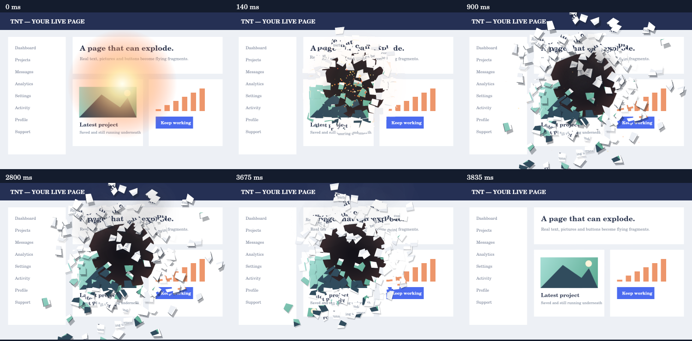

# WebTNT · TNT 悬浮爆炸工具

将像素 TNT 放在网页上，左键拖到目标位置并松开，炸开附近的文字、图片、按钮和卡片。碎片保留原网页的外观，散落停留后快速回吸复原；网页本身继续运行。

**当前版本：1.0.7。第一阶段为 Chrome／Edge Manifest V3 浏览器扩展，Windows 桌面应用列入后续计划。** 扩展没有构建步骤、第三方运行依赖或后端服务。



上图由项目中的真实渲染引擎绘制，使用自制测试场景，展示爆炸后的六个时刻；不是浏览器截图或录屏。浏览器实机验证状态见 [验证记录](docs/verification.md)。

## 功能

- 自绘立体像素 TNT，右键移动固定图标，左键拖出独立目标并松开引爆。
- 点燃火花、闪光、冲击波、烟雾、碎片阴影与厚度；冲击由中心向外传播。
- 原画面碎片以不同方向和距离散落，爆心留下带凹角、切口与裂纹的不规则缺口。
- 本地图片可以作为爆炸后的背景，缺口大小独立于爆炸强度。
- 停留阶段保留细微动效，随后回吸拼合，结束时显示网页当前最新画面。
- 隐藏、关闭、立即还原，以及图标下方文字开关。
- 宣传片同源的原创点燃火花、低频爆炸碎裂、回吸拼合音效，按实际动画阶段播放。

1.0.7 将宣传片中的原创音效接入真实使用。更新后，在插件弹窗开启 **“原创爆炸音效”**，或在 TNT 设置面板勾选 **“点燃、爆炸与回吸音效”**。默认仍关闭，已有开关选择会保留。截图准备期间不会提前响爆炸声，关闭音效或取消效果立即停止当前声音。

1.0.6 修复了左键投放后，燃烧目标在“准备画面”阶段提前消失的问题：截图返回后立即恢复目标，图片解码和碎片缓存准备期间继续显示，首个爆炸画面接替后才移除。实际截图时仍需短暂隐藏悬浮层，避免把 TNT 一起截进网页碎片。

## 安装到 Chrome／Edge

1. 在 [GitHub 仓库](https://github.com/Changhooo/webtnt) 点击 **Code → Download ZIP**，完整解压。也可以克隆仓库。
2. 打开 `chrome://extensions/` 或 `edge://extensions/`，开启“开发者模式”。
3. 点击“加载已解压的扩展程序”，选择解压后的 **`webtnt-main/extension` 文件夹**。正确目录直接包含 `manifest.json`。
4. 打开一个普通网页，点击浏览器工具栏的 **TNT · 网页爆破**，再点击“显示 TNT”。建议把扩展固定到工具栏。

如果使用测试打包流程生成的精简安装 ZIP，选择解压后直接包含 `manifest.json` 的目录即可。扩展不自动常驻所有网站；新页面或刷新后，可从工具栏再次启用。

更新旧版时，覆盖原安装目录中的扩展文件，在扩展管理页点击“重新加载”，然后刷新需要使用的网页。若是完整源码 ZIP，只复制其中 `extension` 的内容到原扩展目录。

## 操作

| 操作 | 结果 |
| --- | --- |
| 按住右键拖动 TNT | 改变固定图标位置，松开不引爆 |
| 按住左键拖动，再松开 | 独立 TNT 目标跟随鼠标，松开后在准确落点点燃；固定图标全程保持原位 |
| 左键单击 TNT | 在点击位置点燃并引爆 |
| 单独右击 TNT | 打开立即还原、设置、隐藏和关闭菜单 |
| 点击悬浮工具栏“文” | 显示／隐藏固定图标与目标下方的文字 |
| 按 `Esc` | 取消拖动目标或立即结束当前效果 |
| 工具栏弹窗“隐藏”／“显示 TNT” | 隐藏工具或重新显示 |
| 工具栏弹窗“立即还原” | 清除动画，露出当前网页 |
| 工具栏弹窗“关闭” | 结束当前网页的工具会话 |

文字开关也可从插件弹窗按钮或设置面板复选框调整，保存到本机并同步到已启用的标签页。隐藏下方文字后仍保留悬停说明和可访问性标签。

悬浮层只有 TNT、工具栏、菜单和设置面板接收点击，其余区域允许正常操作网页。滚动、缩放、改变窗口尺寸或切换标签页会取消当前效果，避免截图与网页错位。进入全屏会隐藏工具，退出后可重新启用。

## 设置与动画节奏

| 设置 | 默认值 | 可调范围 |
| --- | --- | --- |
| 爆炸半径 | 250 px | 100–450 px |
| 效果强度 | 1.0 | 0.5–1.8 |
| 缺口大小 | 爆炸半径的 65% | 35%–100% |
| 点燃 | 0.8 秒 | 0.2–2 秒 |
| 爆炸与散落 | 1 秒 | 0.5–1.8 秒 |
| 破坏效果停留 | 2.5 秒 | 0.5–6 秒 |
| 快速复原 | 0.35 秒 | 0.2–0.8 秒 |
| 音效 | 关闭 | 开／关 |
| 图标下方文字 | 显示 | 显示／隐藏 |

点燃结束后需要捕获并准备网页画面，其耗时取决于浏览器和页面，不包含在上述四段默认时长中。

### 原创音效

| 阶段 | 声音 |
| --- | --- |
| 松手点燃 | 点燃咔哒与循环火花，准备画面期间继续燃烧 |
| 首个爆炸画面 | 低频冲击与不对称碎片散落 |
| 回吸复原 | 上行风声、加速拼合与收尾提示，随复原速度调整 |

音效随爆点产生轻微左右声像，全部从安装包本地读取，预加载并复用解码缓存。按 Esc、立即还原、隐藏、关闭或关掉音效开关都会清除播放，迟到的加载结果不能重新响起。音频不可用时，视觉动画仍继续。

素材与宣传片出自同一原创合成源，采用 MIT 许可，见 [音效说明](extension/assets/audio/README.md)。开发者可用 `python tools/generate_audio.py` 重建 WAV；仅重建素材时需要 NumPy，普通安装和测试无需它。

在插件弹窗的“爆炸后的背景”里选择本地 **JPEG、PNG 或 WEBP**，支持预览、替换和移除。输入最大 20 MiB，自动等比例缩小至最长边 1600 px，并限制保存的数据大小；缺口内按比例居中裁切。图片只保存在本机，不随源码分发。移除后恢复默认深色背景。

## 测试网页

项目提供普通测试网页，包含文字、SVG 图片、表单、计数按钮、实时钟、Canvas 动画、同源及隔离 iframe，以及本地动态视频。它需要安装并启用扩展，不内置 TNT 特效。

在仓库根目录启动服务器，需要 Python 3：

```bash
python -m http.server 8765
```

打开 [http://localhost:8765/demo/](http://localhost:8765/demo/)，再从工具栏点击“显示 TNT”。直接打开 `demo/index.html` 时，需要在扩展详情里开启“允许访问文件网址”；本地 HTTP 更适合检查 iframe 行为。

## 原理、权限与兼容性

扩展捕获当前可见标签页，从爆点周围画面生成不规则碎片，在独立 Canvas 覆盖层播放效果。文字、按钮、图片和视频帧的视觉特征来自实际截图，原网页的 DOM、表单和播放状态继续运行。碎片使用捕获时刻的画面；复原后移除覆盖层，展示最新网页。

| 权限 | 用途 |
| --- | --- |
| `activeTab` | 用户启用后访问当前标签页并捕获可见画面 |
| `scripting` | 注入悬浮控件与渲染层 |
| `storage` | 在本机保存设置和自定义背景 |

不申请所有网站的常驻访问权限。截图仅用于当前动画，不上传；不需要账号。截图外缘的裁边细片保留与网页的连接，外围阴影和厚度随影响减弱，避免拼成圆形暗边。碎片、烟雾、背景和缓存在完成或取消后清理。

普通网页是当前版本的主要目标。`chrome://`、`edge://`、扩展商店和部分内置页面不能注入。受保护视频可能无法捕获，特殊全屏及内置 PDF 查看器需另外验证。当前扩展只能在浏览器网页中运行。

## 开发与验证

测试需要 **Node.js 22+**；Python 3 用于测试页与打包。扩展安装本身不需要 Node.js。

```bash
git clone https://github.com/Changhooo/webtnt.git
cd webtnt
npm ci
npm test
```

当前 77 项程序级检查通过，覆盖真实控制器脚本、模拟浏览器接口、原生 Canvas 像素、碎片分布、设置、异步取消及资源清理。音频用例检查阶段触发、用户手势恢复、缓存复用、变速回吸、立即静音和迟到结果清理；截图与解码延迟期间不会提前播放爆炸声。**这不等同于 Chrome／Edge 实机截图授权、音频设备试听、视频兼容性或帧率验收。** 当前测试环境无法启动 Chromium，实机项保留待验收。

可在支持的本地环境另行运行：

```bash
npx playwright install chromium
npm run test:browser
```

生产配置的 `activeTab` 授权需通过真实工具栏操作检查。隔离测试模式和退出码见 [验证记录](docs/verification.md)，实机步骤见 [手动检查清单](docs/manual-checklist.md)。

GitHub Actions 配置在推送和 Pull Request 时执行测试并生成安装、源码 ZIP，产物位于对应运行的 **Artifacts → TNT-Blast**。本地打包命令：

```bash
python tools/package.py --install-only --output dist/TNT_Blast_install.zip
python tools/package.py --output dist/TNT_Blast_source.zip
```

打包会检查脚本语法、生产权限、资源和 ZIP 完整性，排除依赖目录、构建产物及内部测试输出。

## 项目结构与文档

| 路径 | 内容 |
| --- | --- |
| `extension/` | 可直接加载的浏览器扩展 |
| `extension/content.js` | 拖动、目标预览、动画时序与生命周期 |
| `extension/engine.js` | 碎片、破碎缺口、烟雾、阴影与回吸渲染 |
| `extension/audio.js` | 本地音效缓存、阶段播放与音频生命周期 |
| `extension/assets/audio/` | 宣传片同源原创 WAV 与素材说明 |
| `extension/background.js` | 当前标签页截图适配器 |
| `demo/` | 普通测试网页与自制素材 |
| `tests/` | 程序级、像素和可选浏览器测试 |
| `tools/package.py` | 安装包与源码包生成 |
| `tools/generate_audio.py` | 音效素材可复现生成 |

- [技术结构与 Windows 迁移计划](docs/architecture.md)
- [验证记录](docs/verification.md)
- [手动验收清单](docs/manual-checklist.md)
- [更新记录](CHANGELOG.md)
- [贡献说明](CONTRIBUTING.md)

遇到问题可在 [Issues](https://github.com/Changhooo/webtnt/issues) 提供浏览器版本、系统、页面类型、缩放、设置和复现步骤。

## Windows 后续计划

复用爆炸算法、动画节奏、素材和音效，增加桌面／窗口画面捕获、透明置顶悬浮窗、鼠标穿透、托盘、多显示器和 DPI 适配。先覆盖普通桌面与软件窗口，再分别验证独占全屏、受保护画面和系统安全界面。**Windows 应用尚未实现，仓库当前不提供桌面安装包。**

## 许可

代码采用 [MIT 许可证](LICENSE)。TNT 为自绘的像素风格素材，本项目与 Mojang、Microsoft 和 Minecraft 官方无关联，相关名称与商标属于各自权利人。
